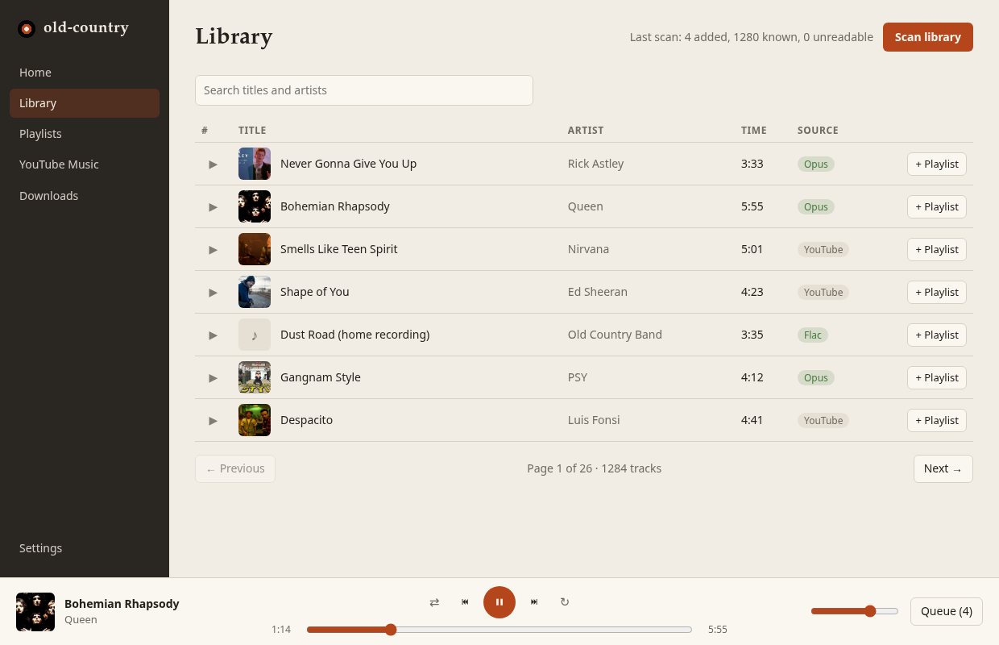
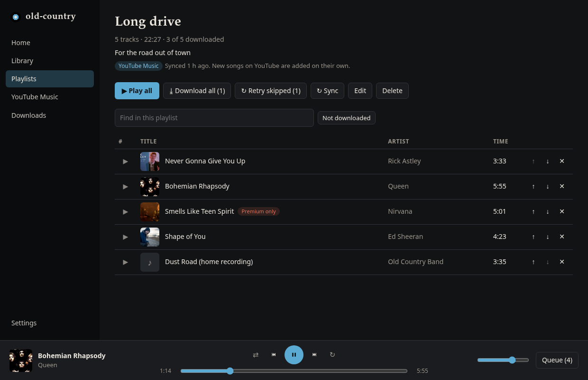
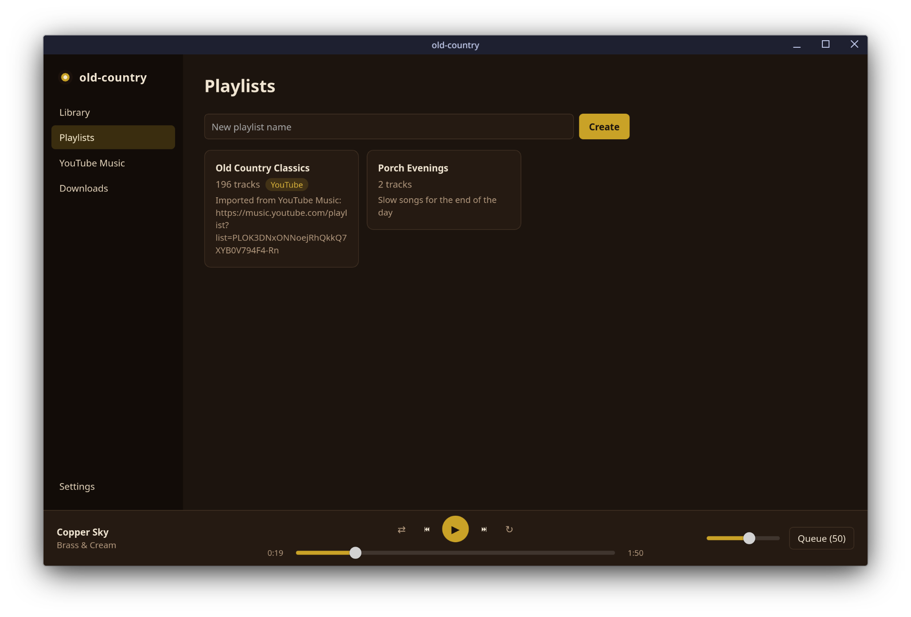
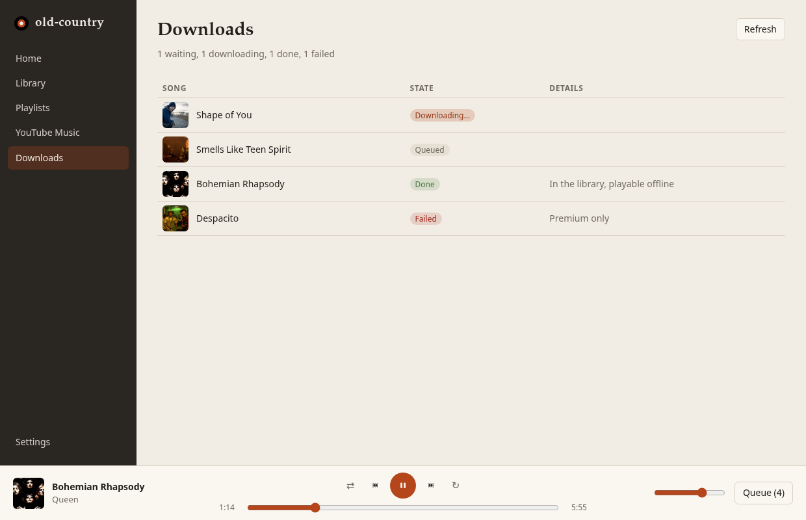
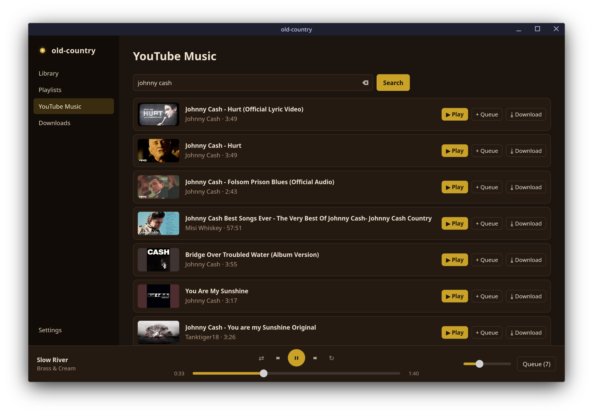
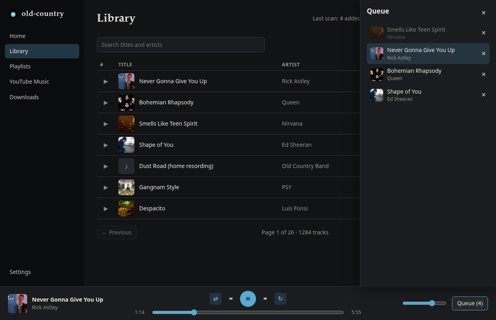
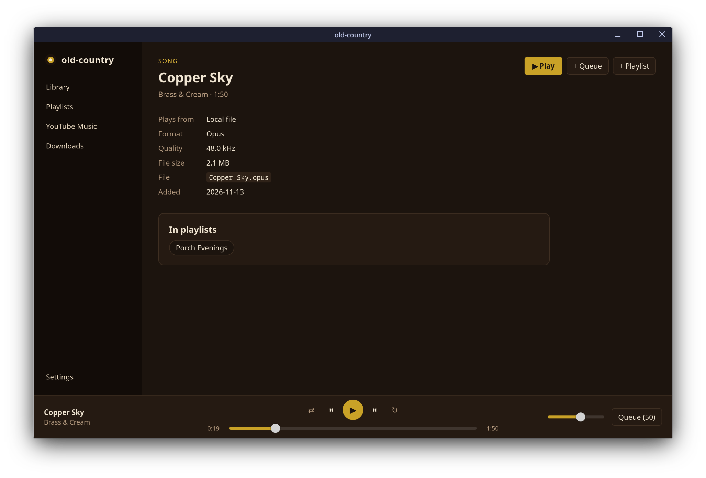
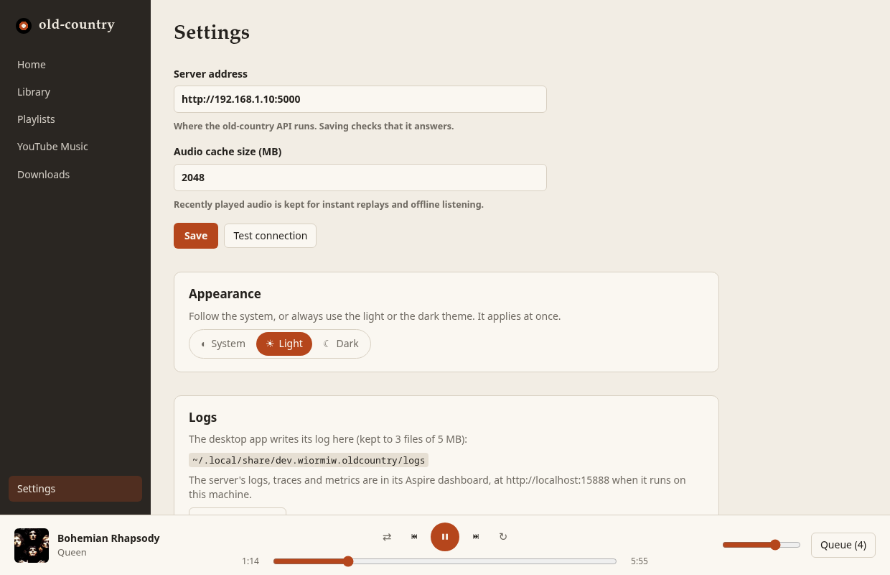
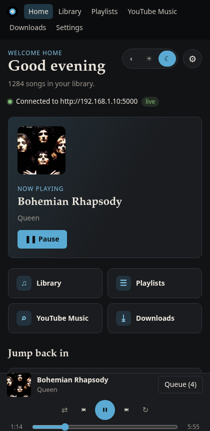

# old-country

A personal music player: your offline library plus YouTube Music, in one place.

- **Library**: scans your music folders (FLAC, MP3, AAC/ALAC, Opus, Vorbis, WAV), reads tags, and streams files with seeking.
- **Playlists**: ordered, editable, duplicates allowed.
- **YouTube Music**: search, play, download for offline, and import playlists or your liked songs.
- **Playlist sync**: an imported playlist stays linked to YouTube Music. The server checks it every 6 hours (or when you press **Sync**) and appends songs added on YouTube since; your renames, reordering and removals are kept.
- **Downloads**: one song or a whole playlist ("Download all"), queued in the database so they survive restarts, paced so YouTube doesn't block you, and songs YouTube refuses are remembered to retry later.
- **Desktop app** (Linux, Windows, macOS): native playback with media keys, shuffle and repeat, an offline audio cache, a layout that fits a narrow window, and one window only (starting it again brings the open one forward).
- **Android app**: the same features, with background playback, lock-screen and notification controls, and songs kept on the phone for offline replays.

| Part | Stack | Status |
|---|---|---|
| [`backend/`](backend/) | .NET 11 / C# 15, ASP.NET Core minimal APIs, EF Core 11, PostgreSQL 18, Aspire | Working |
| [`desktop/`](desktop/) | Tauri v2, Leptos 0.8 (Rust/WASM) UI, native playback (rodio, symphonia, libopus) | Working |
| [`android/`](android/) | Kotlin, Jetpack Compose (Material 3), Media3 ExoPlayer + MediaSession | Working |

The backend runs on a home server; the apps talk to it over the LAN.

## Installing the apps

Download them from [Releases](https://github.com/wiormiw/old-country/releases) (desktop and Android are released separately):

| System | File | Notes |
|---|---|---|
| Debian, Ubuntu | `old-country_<version>_amd64.deb` | `sudo apt install ./old-country_*.deb` |
| Fedora, openSUSE | `old-country-<version>-1.x86_64.rpm` | `sudo dnf install ./old-country-*.rpm` |
| Any Linux | `old-country_<version>_amd64.AppImage` | `chmod +x` it and run it |
| Windows | `old-country_<version>_x64-setup.exe` or `.msi` | SmartScreen may warn because the app isn't code-signed: **More info → Run anyway** |
| macOS | `old-country_<version>_aarch64.dmg` (Apple Silicon) or `_x64.dmg` (Intel) | Not notarized: the first time, right-click the app and choose **Open** |
| Android 8+ | `old-country_<version>_android.apk` (an Android release) | Allow installing from your browser or file manager when asked; later versions install over it |

On first start, open **Settings** and enter the server address as that device reaches it (e.g.
`http://192.168.1.10:5000` on the same Wi-Fi).

## Screenshots



| | |
|---|---|
|  |  |
| **Imported playlist**: when it last synced, Sync now, Download all, find and "Not downloaded" filter | **Playlists**: the YouTube badge marks the ones that sync |
|  |  |
| **Downloads**: the queue, what's done, what YouTube refused | **YouTube Music**: search, play, queue, download, import |
|  |  |
| **Queue**: shuffle order, repeat-all on | **Song page**: where it plays from, quality, file, playlists |
|  |  |
| **Settings**: server address, cache size, where the logs are | **Narrow window**: the sidebar becomes a top bar |

## Running the backend

**Prerequisites**

- .NET 11 SDK (`dotnet --list-sdks` shows `11.0.x`)
- Docker (Postgres for development and integration tests)
- [yt-dlp](https://github.com/yt-dlp/yt-dlp), ffmpeg and Node.js 22+ (YouTube Music features; yt-dlp runs YouTube's JavaScript in Node)

**Start everything** (Postgres container, the API, and the Aspire dashboard for logs and traces):

```bash
cd backend
dotnet run --project src/OldCountry.AppHost
```

| What | Where |
|---|---|
| API | `http://localhost:5000` on this computer; `http://<its LAN address>:5000` from a phone or another computer (set it in the app's Settings) |
| Aspire dashboard | `http://localhost:15888` (the login link is printed at startup) |
| PostgreSQL | `localhost:55432`, user `postgres`, database `oldcountry`, data in a persistent Docker volume |

To use it from a phone, the firewall has to let the home network in on port 5000, e.g. with ufw:
`sudo ufw allow from 192.168.1.0/24 to any port 5000 proto tcp`. Use `http://` (not https) and
port 5000; other ports in the Aspire dashboard are internal and change on every start.

The Postgres password is an Aspire secret kept in the AppHost's user secrets, not in the repo. Set it
once, and point the API at your music:

```bash
dotnet user-secrets set Parameters:postgres-password '<choose one>' --project src/OldCountry.AppHost
dotnet user-secrets set MusicFolder /path/to/music --project src/OldCountry.AppHost
dotnet user-secrets list --project src/OldCountry.AppHost   # shows both
```

**Just the API, without Aspire** (after running the AppHost once, so the database and secrets exist):

```bash
cd backend
./run-api.sh    # same database and music folder as the AppHost; logs in the terminal; Ctrl+C to stop
```

It starts the AppHost's Postgres container, reads the password and music folder from the AppHost's
user secrets, starts Aspire's standalone dashboard on `http://localhost:18888` (no sign-in, local
only; `--no-dashboard` skips it), and runs the API on `http://localhost:5000` (`API_PORT=...` to change).
Ctrl+C stops the API and the dashboard.

Migrations run on startup in Development. The API's OpenAPI document is at `/openapi/v1.json` and an interactive UI at `/scalar`. `src/OldCountry.Api/OldCountry.Api.http` has a ready-made request for every endpoint.

**Configuration** (appsettings, environment variables like `Library__Roots__0`, or user secrets):

| Setting | Default | Meaning |
|---|---|---|
| `ConnectionStrings:oldcountry` | set by Aspire | PostgreSQL connection |
| `Library:Roots` | `[]` | Absolute music folders to scan and serve. Empty disables scanning. |
| `Library:RescanInterval` | `06:00:00` | Scheduled rescan; `00:00:00` turns it off |
| `Library:ScanOnStartup` | `true` | Scan when the server starts |
| `YouTubeMusic:YtDlpPath` | `yt-dlp` | yt-dlp executable |
| `YouTubeMusic:JsRuntime` | `node` | JavaScript runtime yt-dlp uses for YouTube: `node`, `deno`, `quickjs` or `bun`, optionally `node:/path/to/node`. Empty uses yt-dlp's default (Deno, whose development ends in 2027). |
| `YouTubeMusic:CookiesFile` | none | Browser-exported `cookies.txt`; needed for private playlists and liked songs |
| `YouTubeMusic:DownloadFolder` | `<first root>/YouTube Music` | Must be inside a library folder |
| `YouTubeMusic:AudioFormat` | `opus` | `opus`, `m4a`, `mp3` or `flac` |
| `YouTubeMusic:StreamCacheFolder` | system temp | Cache for YouTube audio being played |
| `YouTubeMusic:StreamCacheMaxMegabytes` | `2048` | Least recently played files are evicted first |
| `YouTubeMusic:DownloadPause` | `00:00:05` | Wait between one download and the next |
| `YouTubeMusic:PlaylistSyncInterval` | `06:00:00` | How often imported playlists sync with YouTube Music on their own; `00:00:00` turns it off |
| `YouTubeMusic:RateLimitPause` | `00:15:00` | How long downloads rest when YouTube rate limits; doubles if it happens again in a row (up to 8x) |

Bad configuration stops the server at startup with a message naming the setting.

## Deploying to a server

Aspire's AppHost is a development tool: it starts Postgres and the API on your machine and shows
the dashboard. On a server, `backend/deploy/` runs the same pieces with Docker Compose. That means
PostgreSQL 18, the API image (with yt-dlp, Node.js and ffmpeg built in), and optionally Aspire's
dashboard on its own.

```bash
# On the server (Docker with the compose plugin installed)
git clone <this repo> && cd old-country/backend/deploy
cp .env.example .env && nano .env      # password, MUSIC_DIR, PUID/PGID (run `id`)
docker compose up -d --build           # API on http://<server>:5000
docker compose logs -f api
```

| Task | Command (in `backend/deploy`) |
|---|---|
| Update after `git pull` | `docker compose up -d --build` (migrations run on start) |
| Update yt-dlp | bump `YTDLP_VERSION` in `.env`, then `docker compose up -d --build` |
| Logs and traces | set `OTEL_EXPORTER_OTLP_ENDPOINT=http://dashboard:18889` in `.env`, run `docker compose --profile dashboard up -d`, then open `http://<server>:18888` with the link from `docker compose logs dashboard` |
| Liked songs, private playlists | put `cookies.txt` here, `cp compose.override.example.yaml compose.override.yaml`, `docker compose up -d` |
| Back up the database | `docker compose exec postgres pg_dump -U postgres oldcountry > backup.sql` |

The database has no published port, so only the API can reach it. The API itself has no
authentication: keep it on your LAN or behind a VPN, not open to the internet.

## Running the desktop app

The desktop app is a Tauri v2 window with a Leptos UI compiled to WebAssembly. It plays audio
natively (not through the webview), so playback keeps going while the window is minimised and
answers the desktop's media keys.

**Prerequisites** (Arch package names; Rust from the distro, not rustup):

```bash
sudo pacman -S rust rust-wasm trunk webkit2gtk-4.1 opus   # rust-wasm = wasm32 standard library
cargo install tauri-cli --version '^2' --locked
```

**Run** (the backend must be running somewhere on the LAN):

```bash
cd desktop
cargo tauri dev      # Trunk serves the UI on :1420, Tauri opens the window
cargo tauri build    # .deb, .rpm and AppImage under target/release/bundle/
```

**Install for everyday use** (release build, launcher entry and icon, for the current user):

```bash
packaging/install-linux.sh              # again after pulling changes; --uninstall removes it
```

On first start, open **Settings** and enter the server address (e.g. `http://192.168.1.10:5000`);
saving checks the server's `/health`.

**How it fits together**

```
desktop/
  shared/      the server's JSON and the IPC types, compiled into both sides
  app/         Leptos UI (wasm): pages, now-playing bar; talks only to the core
  src-tauri/   Tauri core: settings, API client, Tauri commands, the player
    src/player/  cache (progressive download), decoder (symphonia + libopus), engine (thread + queue), media keys
```

- **The UI never does HTTP.** Every server call is a Tauri command run by the core with reqwest,
  so the backend needs no CORS and there's one place for the server address.
- **Playback**: rodio is only the audio output. Decoding is symphonia 0.6 plus libopus (symphonia
  has no Opus decoder, and YouTube audio is Opus); rodio's own decoder is on symphonia 0.5, which
  the libopus adapter can't plug into.
- **Audio cache**: a track streams into the cache while it plays; the decoder reads the growing file
  and waits for bytes it reaches early. Finished files replay offline and are evicted least recently
  played first (2 GB by default, set in Settings).
- **Shuffle and repeat**: shuffle is a bag, not a random pick per song. Every song plays once before
  any song plays again; with repeat-all, each cycle is reshuffled (and never opens with the song that
  just ended), and songs added mid-cycle join the unheard part. Repeat-one replays a song when it ends;
  Next still moves on. Both are remembered between sessions.
- **No crackles under load**: decoding runs a few seconds ahead on its own thread, so the sound card's
  real-time callback only copies ready samples, through a roomier 4096-frame output buffer.
- **Silent when paused**: the sound card stream opens when a song plays and closes 3 seconds after
  it pauses or stops, so the desktop doesn't show the app as playing audio (KDE's speaker icon on the
  task bar). The paused song and its position are kept while it's closed.
- **Media keys**: MPRIS (souvlaki), so KDE's media controls show the current song and work while the
  window is hidden.

**Tests**: `cargo test --workspace` decodes generated FLAC, MP3, AAC, Vorbis, Opus (Ogg and WebM)
and WAV files (needs ffmpeg), and covers the progressive reader, the queue, the API client against a
stub server, and the shared types. `cargo clippy --workspace --all-targets -- -D warnings` is clean.

## Running the Android app

A Kotlin app with a Jetpack Compose UI. Playback runs in a Media3 `MediaSessionService`, so it
keeps going with the screen off and shows up in the notification shade, on the lock screen, and on
Bluetooth controls.

**Prerequisites**: JDK 21 and the Android SDK (Android Studio brings both; or the command-line
tools, with `sdk.dir` in `android/local.properties`).

```bash
cd android
./gradlew :app:assembleDebug        # app/build/outputs/apk/debug/, installs beside a release build
./gradlew :app:testDebugUnitTest    # JSON parsing, the API client against a stub server, labels
adb install -r app/build/outputs/apk/debug/app-debug.apk
```

In the emulator the computer running the server is `10.0.2.2`, so the address is `http://10.0.2.2:5000`.

**How it fits together**

```
android/app/src/main/java/dev/wiormiw/oldcountry/
  data/       the server's JSON (kotlinx.serialization), the API client (OkHttp), settings (DataStore)
  playback/   PlaybackService (ExoPlayer + MediaSession), the audio cache, the screens' PlayerConnection
  ui/         Compose screens: Library, Playlists, YouTube, Downloads, Settings, and the player
```

- **Same server, same rules**: songs only on YouTube stream through the server's YouTube endpoint,
  downloaded ones from the library; wording and error labels match the desktop app.
- **Songs kept on the phone**: Media3's cache, keyed by song rather than URL, so changing the server
  address keeps it. Least recently played go first once it's full (2 GB by default, set in Settings).
  The next song is fetched while the current one plays.
- **Skips what can't play**: up to 3 unplayable songs in a row are skipped, like the desktop.
- **Plain HTTP is allowed** (`network_security_config.xml`), since the server is usually
  `http://` on the home network.

## Making a release

The desktop and Android apps are released separately, each with its own version and tag:

| App | Version in | Tag | Workflow |
|---|---|---|---|
| Desktop | `desktop/Cargo.toml` | `desktop-v0.1.0` | [release-desktop.yml](.github/workflows/release-desktop.yml): Linux, Windows, macOS (Apple Silicon and Intel) |
| Android | `appVersion` in `android/gradle.properties` | `android-v0.1.0` | [release-android.yml](.github/workflows/release-android.yml): the signed APK |

Bump the version, commit, then tag and push, e.g.:

```bash
git tag android-v0.1.1 && git push origin android-v0.1.1
```

Each workflow attaches its files to a **draft** release; check it over on GitHub and press
**Publish**. A tag that doesn't match the version in the file is refused. Both can also be started
from the Actions tab.

The APK is signed with a release key kept out of the repository. CI reads it from four repository
secrets (**Settings → Secrets and variables → Actions**):

| Secret | Value |
|---|---|
| `ANDROID_KEYSTORE_BASE64` | `base64 -w0 release.jks` |
| `ANDROID_KEYSTORE_PASSWORD` | the keystore password |
| `ANDROID_KEY_ALIAS` | the key alias |
| `ANDROID_KEY_PASSWORD` | the key password |

Local release builds read the same values from `android/keystore.properties` (git-ignored:
`storeFile`, `storePassword`, `keyAlias`, `keyPassword`). Keep a backup of the keystore: Android
only installs an update signed with the same key.

## Logs

| App | Where |
|---|---|
| API | The Aspire dashboard (`http://localhost:15888`): **Console** for raw output, **Structured** for searchable log events, **Traces** for each request with its SQL and yt-dlp calls. |
| Desktop | `~/.local/share/dev.wiormiw.oldcountry/logs/old-country.log` (3 × 5 MB, rotated), plus the terminal under `cargo tauri dev`. **Settings → Logs** shows the folder and opens it. |
| Android | `adb logcat -s PlaybackService` for playback; the rest of the app reports errors on screen. |

```bash
tail -f ~/.local/share/dev.wiormiw.oldcountry/logs/old-country.log
```

## API at a glance

| Area | Endpoints |
|---|---|
| Tracks | `POST /api/tracks`, `GET /api/tracks`, `GET /api/tracks/{id}`, `GET /api/tracks/{id}/audio` |
| Library scans | `POST /api/tracks/scans`, `GET /api/tracks/scans/latest` |
| Playlists | `POST/GET /api/playlists`, `GET/PUT/DELETE /api/playlists/{id}`, `POST /api/playlists/{id}/tracks`, `DELETE /api/playlists/{id}/tracks/{position}`, `POST /api/playlists/{id}/tracks/move` |
| YouTube Music | `GET /api/youtube-music/search`, `GET /api/youtube-music/videos/{videoId}/audio`, `POST/GET /api/youtube-music/downloads`, `POST /api/youtube-music/playlists/{id}/downloads`, `POST /api/youtube-music/playlists/{id}/sync`, `POST /api/youtube-music/imports` |

Errors are [RFC 9457](https://www.rfc-editor.org/rfc/rfc9457) problem details with a stable `code` field (`track.not_found`, `validation`, `youtube.failed`, ...).

## Backend design

```
backend/
  src/
    OldCountry.Domain/            entities, value objects, rules; references nothing
    OldCountry.Api/
      Features/<Feature>/<UseCase>/   one file per use case: request, validator, handler, endpoint
      Common/                         messaging, decorators, validation, errors, shared library helpers
      Persistence/                    DbContext, conventions, configurations, migrations
    OldCountry.ServiceDefaults/   OpenTelemetry, health checks, resilient HttpClients
    OldCountry.AppHost/           Aspire orchestration for development
  tests/                          Domain, Api (unit + integration), Architecture
```

- **Hybrid architecture.** Only the Domain is a "clean" layer. Everything else is vertical feature slices in one project; features never reference each other (enforced by architecture tests) and share only through Domain and `Common/`.
- **Explicit DI, no mediator.** Each feature lists its registrations (`TracksFeature.AddServices`), and `FeatureRegistry` lists every feature. Handlers are wrapped in hand-composed decorators (logging → transaction → handler) in `Common/Messaging/HandlerRegistration.cs`. No MediatR, AutoMapper or assembly scanning.
- **Results as C# 15 unions.** A use case returns e.g. `union GetTrackResult(TrackResponse, NotFoundError)`; endpoints `switch` over it exhaustively, so a new outcome won't compile until it is handled. Exceptions are for bugs.
- **Validation** with FluentValidation: one validator per request, run by an endpoint filter (`.Validate<T>()`) before the handler. The domain still enforces its own invariants.
- **Value objects are records**: strongly-typed ids (`readonly record struct`) via model-wide converters, `LocalFile`/`AudioQuality` as EF Core complex types, playlist entries as a JSON complex collection. snake_case names throughout.
- **Logging** only through source-generated `[LoggerMessage]` methods; CA1848/CA2254/CA1727/CA1873 are build errors.
- **Security**: audio is served only from inside the configured library folders (symlinks resolved), whatever path a track claims.

### YouTube Music notes

Everything goes through yt-dlp, run as a child process with a timeout. Playing a YouTube track fetches its audio into a size-capped cache and serves the file, rather than relaying YouTube's stream URLs: those are bound to the resolving IP, reject the HTTP `Range` header, and for some clients are refused unless fetched exactly as yt-dlp does (tested Nov 2026).

**Downloads** go into the library folder, as ordinary files: `<first Library:Roots folder>/YouTube Music/<artist>/<title> [<video id>].opus`. The library scan sees them like any other music, and they keep playing whatever happens to your YouTube account. On a server, that's the server's disk, or a NAS mounted there.

The download queue is a table in Postgres, worked through one song at a time by a background worker:

- **Survives restarts.** Queued songs stay queued. A song interrupted by a normal shutdown goes back in the queue; one interrupted by a crash is taken again when its *lease* runs out (a worker owns a song for twice the yt-dlp timeout plus two minutes). A song that never finishes is given up after 3 tries.
- **Easy on YouTube.** A pause between songs, and when YouTube rate limits ("429", "confirm you're not a bot") the whole queue rests and resumes by itself. The Downloads page says until when.
- **Remembers refusals.** A song YouTube won't give (Premium only, private, removed, age or region restricted) is marked on the track. "Download all" on a playlist skips those; "Retry skipped" tries them again, e.g. after getting Premium or adding cookies.

**Playlist sync.** An imported playlist remembers its YouTube list id and every video it has taken from it. A sync is the same import again, and it adds only videos the playlist has never taken, so:

- songs added on YouTube are appended, in YouTube's order;
- a song you removed here stays removed, even while it's still on YouTube;
- a song removed on YouTube stays here (it's yours now, and may be downloaded);
- the name, description and order you gave it are kept.

A background service checks every 15 minutes for linked playlists last synced more than `YouTubeMusic:PlaylistSyncInterval` ago (6 hours; `00:00:00` turns it off) and syncs them one at a time. It rests together with the download queue when YouTube rate limits, and after a failure (say, the playlist was deleted on YouTube) it leaves that playlist alone for one interval. Liked songs (`LM`) sync only when `YouTubeMusic:CookiesFile` is set. The app's **Sync** button (`POST /api/youtube-music/playlists/{id}/sync`) does it at once.

Keeping YouTube playback steady:

- **The server owns each fetch.** If you skip a song while its audio is still being fetched, the fetch keeps going and finishes in the cache. Two requests for the same song share one fetch.
- **One retry.** A failed yt-dlp run is retried once after 2 seconds, since YouTube often fails just once.
- **Prefetch.** While a song plays, the desktop app starts fetching the next one, so YouTube songs start without the wait.
- **Skip on error.** A song that still fails is skipped, so one bad song doesn't stop the queue.

Downloading from YouTube may be against its Terms of Service; this is a personal tool.

## Tests

```bash
cd backend
dotnet test --solution OldCountry.slnx                 # unit, architecture, and (with Docker) integration tests
OLDCOUNTRY_LIVE_YTDLP=1 dotnet test --solution OldCountry.slnx   # also run against real YouTube with the installed yt-dlp
```

Integration tests start a throwaway PostgreSQL with Testcontainers and are skipped when Docker isn't running. They use a fake yt-dlp; the live tests are the check that real yt-dlp output still parses.

## Notes

- EF Core is pinned to `11.0.0-rc.3` because the Npgsql provider for EF Core 11 is still a release candidate and requires that exact build. Bump `EfCoreVersion` in `backend/Directory.Packages.props` together with Npgsql when it ships GA.
- `dotnet tool restore` installs the matching `dotnet-ef` for migrations: `dotnet ef migrations add <Name> --project src/OldCountry.Api --output-dir Persistence/Migrations`.
